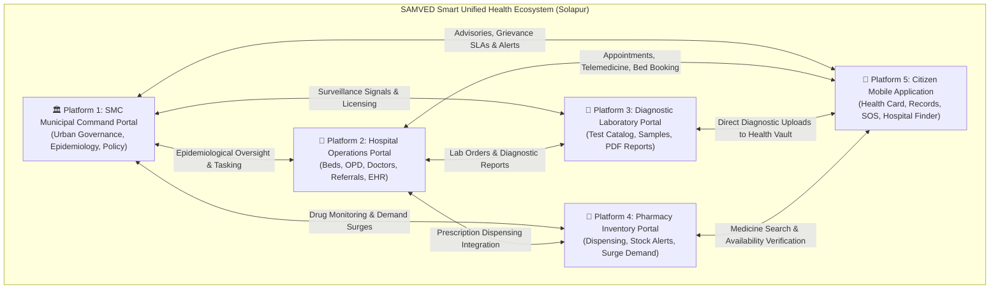
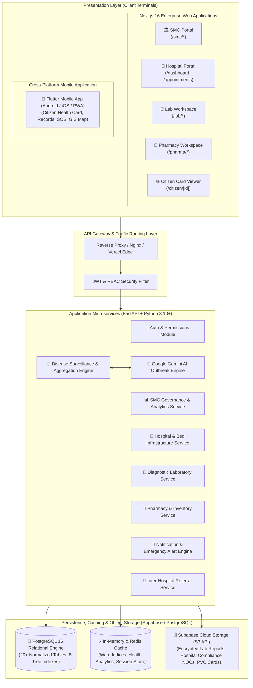

# SAMVED — Smart Unified Public Health Ecosystem
## Comprehensive Final Project Architecture & Platform Technical Report
**Project Name:** SAMVED (Solapur Municipal Corporation Smart Health Platform)  
**Target Municipality:** Solapur Municipal Corporation (SMC), Maharashtra, India  
**Document Type:** Master System Architecture, Module Specification & Technical Report  
**Version:** 1.0.0 (Production Blueprint)  
**Date:** October 2026  

---

# Table of Contents
1. [Executive Summary & Project Overview](#1-executive-summary--project-overview)
2. [Novelty, Innovations & Unique Value Propositions](#2-novelty-innovations--unique-value-propositions)
3. [The Five Core Platforms: Overview & Purpose](#3-the-five-core-platforms-overview--purpose)
4. [Complete System Architecture & Infrastructure](#4-complete-system-architecture--infrastructure)
   - 4.1 End-to-End Architectural Diagram
   - 4.2 Presentation Layer (Micro-Frontend & Flutter Mobile)
   - 4.3 API & Business Logic Layer (FastAPI Microservices)
   - 4.4 Data & Cloud Storage Layer (PostgreSQL & Supabase S3)
   - 4.5 Artificial Intelligence & Surveillance Layer (Google Gemini)
5. [Aggregated Health Index (AHI) & Risk Score Formulation](#5-aggregated-health-index-ahi--risk-score-formulation)
   - 5.1 Mathematical Philosophy & Normalized Dimensions
   - 5.2 Underlying Mathematical Parameters & Benchmarks
   - 5.3 Composite Formula & Weight Distribution
   - 5.4 Risk Tiers & Automated Action Thresholds
6. [Detailed Platform Deep Dive — 1. SMC Command & Governance Portal](#6-detailed-platform-deep-dive--1-smc-command--governance-portal)
7. [Detailed Platform Deep Dive — 2. Hospital Operations & Clinical Portal](#7-detailed-platform-deep-dive--2-hospital-operations--clinical-portal)
8. [Detailed Platform Deep Dive — 3. Diagnostic Laboratory Portal](#8-detailed-platform-deep-dive--3-diagnostic-laboratory-portal)
9. [Detailed Platform Deep Dive — 4. Pharmacy & Medicine Inventory Portal](#9-detailed-platform-deep-dive--4-pharmacy--medicine-inventory-portal)
10. [Detailed Platform Deep Dive — 5. Citizen Mobile Application (Flutter)](#10-detailed-platform-deep-dive--5-citizen-mobile-application-flutter)
11. [Cross-Platform Data Workflows & Interoperability](#11-cross-platform-data-workflows--interoperability)
12. [Relational Database Schema & Indexing Strategy](#12-relational-database-schema--indexing-strategy)
13. [Security, ABHA Alignment & Governance Compliance](#13-security-abha-alignment--governance-compliance)
14. [Deployment, Scalability & DevOps Blueprint](#14-deployment-scalability--devops-blueprint)
15. [Conclusion & Future Roadmap](#15-conclusion--future-roadmap)

---

# 1. Executive Summary & Project Overview

**SAMVED** (*Smart Automated Municipal Vigilance & Epidemiological Diagnostics*) is an integrated, multi-stakeholder smart public healthcare governance platform purpose-built for urban local bodies (ULBs), starting with the **Solapur Municipal Corporation (SMC)** in Maharashtra. 

Prior to SAMVED, urban municipal healthcare administration suffered from acute institutional fragmentation. Municipal health departments, district civil hospitals, private healthcare institutions, diagnostic pathology centers, retail pharmacies, and citizens operated in rigid operational silos. Critical data regarding bed vacancies, ICU bed availability, communicable disease surges, life-saving drug stocks, and patient referrals existed in disparate paper registers or disconnected local systems. This fragmentation caused:
- Delayed outbreak identification, allowing preventable epidemics (such as Dengue, Malaria, Typhoid, and Gastroenteritis) to spread unchecked.
- Citizen distress during medical emergencies due to lack of visibility into real-time hospital bed availability and ambulance locations.
- Inefficient inter-hospital patient transfers, leading to preventable delays in critical care.
- Inequitable distribution of municipal healthcare personnel, vaccines, and emergency medical supplies across municipal wards.

SAMVED solves this challenge by engineering a **federated, unified digital healthcare ecosystem** that brings every healthcare touchpoint across the municipality into a single real-time data grid. Built upon open digital health standards and aligned with India's **Ayushman Bharat Digital Mission (ABDM)**, SAMVED bridges administrative governance with grassroots clinical delivery.

---

# 2. Novelty, Innovations & Unique Value Propositions

SAMVED is not merely a hospital management system or a municipal dashboard; it introduces architectural and epidemiological innovations that distinguish it from conventional e-governance systems:

```
┌────────────────────────────────────────────────────────────────────────────────────────┐
│                                 SAMVED CORE INNOVATIONS                                │
├───────────────────────────────┬────────────────────────────────────────────────────────┤
│ 1. Dynamic Ward Health Index  │ Real-time algorithmic computation of health resilience │
│    (AHI Engine)               │ (0–100) per municipal ward based on active case loads, │
│                               │ bed saturation, doctor ratios, and vaccination coverage.│
├───────────────────────────────┼────────────────────────────────────────────────────────┤
│ 2. Tri-Algorithmic Outbreak   │ Simultaneous application of surge thresholds, 4-week   │
│    Surveillance + Gemini AI   │ growth trends, and statistical anomaly detection       │
│                               │ paired with Google Gemini AI for automated root-cause  │
│                               │ explanations and ward-specific advisory drafting.      │
├───────────────────────────────┼────────────────────────────────────────────────────────┤
│ 3. Closed-Loop Prescription   │ Electronic health records (EHR) generate secure digital│
│    & Diagnostic Integration   │ prescriptions and lab orders that route directly to    │
│                               │ pharmacies and diagnostic centers, updating citizen card.│
├───────────────────────────────┼────────────────────────────────────────────────────────┤
│ 4. Early Pharmacy Surge       │ Ingestion of OTC and prescription medication sales to  │
│    Signals as Epidemic Radar  │ detect viral/fever outbreaks 3 to 5 days before        │
│                               │ hospital admissions manifest.                          │
├───────────────────────────────┼────────────────────────────────────────────────────────┤
│ 5. Citywide Rare Medicine &   │ Instant discovery of orphan drugs, anti-snake venoms,  │
│    ICU Bed Federation         │ and ventilator beds across all private and public      │
│                               │ healthcare providers in Solapur.                       │
├───────────────────────────────┼────────────────────────────────────────────────────────┤
│ 6. ABHA-Aligned Digital Card  │ Universal QR-enabled citizen health pass supporting     │
│    with Offline PDF Vault     │ instant doctor triage, offline verification, and       │
│                               │ trilingual citizen accessibility (English/Hindi/Marathi)│
└───────────────────────────────┴────────────────────────────────────────────────────────┘
```

---

# 3. The Five Core Platforms: Overview & Purpose

The SAMVED ecosystem is organized into **five purpose-engineered platforms**, each tailored to the operational demands, data access levels, and workflows of its respective stakeholder group:



### Quick Platform Reference Table

| Platform | Stakeholder Group | Primary Technology | Core Purpose & Value |
| :--- | :--- | :--- | :--- |
| **1. SMC Municipal Command Portal** | Municipal Commissioner, CMO, Ward Health Officers, Epidemiologists | Next.js 16 (App Router), React 19, TypeScript, Recharts, Leaflet GIS | Citywide health governance, Ward Health Indexing, outbreak detection, hospital compliance, resource allocation, and citizen grievance resolution. |
| **2. Hospital Operations Portal** | Medical Superintendents, Doctors, Nurses, Ward Staff, Triage Clerks | Next.js 16, React 19, Tailwind CSS, Shadcn UI, FastAPI REST Client | Real-time bed occupancy tracking, OPD queue and appointment management, EHR, inter-hospital referrals, staff rostering, and notifiable disease reporting. |
| **3. Diagnostic Laboratory Portal** | Lab Directors, Pathologists, Biochemists, Phlebotomists | Next.js 16, React 19, Supabase Storage, Dynamic Micro-Frontend | Test catalog and pricing management, sample collection and barcode tracking, diagnostic parameter entry, PDF report generation, and lab surveillance. |
| **4. Pharmacy Inventory Portal** | Hospital Pharmacists, Retail Chemists, Drug Inspectors | Next.js 16, React 19, Tailwind CSS, Localized State Store | Medicine stock management, batch expiry tracking, EHR prescription dispensing, citywide rare medicine registry, and outbreak surge demand tracking. |
| **5. Citizen Mobile App** | Citizens of Solapur, Patients, Family Caregivers | Google Flutter 3.8+, Dart, Flutter Map, Supabase Flutter, Mobile Scanner | QR-enabled digital health card, health record vault (EHR/Lab/Vaccines), OPD booking, telemedicine, emergency SOS dispatch, and GIS ward risk map. |

---

# 4. Complete System Architecture & Infrastructure

## 4.1 End-to-End Architectural Diagram



## 4.2 Presentation Layer
- **Framework:** Next.js 16.2 with React 19 and TypeScript 5.0+.
- **Rendering Strategy:** Hybrid SSR (Server-Side Rendering) for SEO and initial data loads, paired with React Server Components (RSC) and client-side dynamic micro-frontends for interactive clinical and analytical modules.
- **Styling & Components:** Tailwind CSS 3.4 with Shadcn UI and Radix UI primitives. Fully responsive, WCAG 2.1 AA accessible, with system-aware dark and light modes.
- **Mobile Engine:** Flutter 3.8+ utilizing Material Design 3, `flutter_map` with `latlong2` for offline/online GIS mapping, `mobile_scanner` for camera QR scanning, and `printing` for on-device PDF rendering.

## 4.3 API & Business Logic Layer
- **Engine:** FastAPI (Python 3.10+) running asynchronously on `uvicorn` with `anyio`.
- **Data Validation:** Pydantic v2 schemas providing strict typing, serialization, and automatic Swagger/OpenAPI 3.1 documentation at `/docs`.
- **Performance:** Asynchronous I/O (`async`/`await`) utilizing `asyncio.gather` for parallelized multi-table aggregations.

## 4.4 Data & Cloud Storage Layer
- **Database Engine:** PostgreSQL 16 hosted on Supabase enterprise infrastructure.
- **Data Access:** Dual-channel connectivity via direct asynchronous connection pooling (`SQLAlchemy 2.x` + `asyncpg`) and high-throughput HTTP REST API (`supabase_http_client`) with Row-Level Security (RLS).
- **Object Storage:** Supabase Cloud Storage (AWS S3-compatible) configured with private and public buckets for diagnostic lab reports (`diagnostic-reports`), hospital compliance documents (`hospital-documents`), and citizen avatars.

## 4.5 Artificial Intelligence & Surveillance Layer
- **Engine:** Google Gemini Pro & Flash Generative AI APIs.
- **Role:** Generates clinical epidemiologist analysis of outbreak signals, synthesizes probable transmission vectors, and drafts ward-specific citizen advisories.
- **Fallback Resilience:** Rule-based statistical thresholding ensures 100% operational continuity even when external AI API quotas or networks are constrained.

---

# 5. Aggregated Health Index (AHI) & Risk Score Formulation

A foundational innovation of SAMVED is the **Aggregated Health Index (AHI)**. Rather than relying on simple case counts, SAMVED computes a multidimensional composite score ($0 \le \text{AHI} \le 100$) for each municipal ward. A higher AHI indicates robust public health resilience, while a declining score signals emerging health vulnerability.

## 5.1 Mathematical Philosophy & Normalized Dimensions
The Health Index synthesizes five distinct public health dimensions:
1. **Epidemiological Case Burden Dimension ($D_1$):** Active communicable disease prevalence per capita.
2. **Outbreak Velocity & Acceleration Dimension ($D_2$):** Week-over-week growth rate of new infections.
3. **Clinical Severity & Mortality Dimension ($D_3$):** Proportion of cases requiring ICU/critical care and confirmed mortality.
4. **Healthcare Infrastructure Adequacy Dimension ($D_4$):** Available doctors, nurses, and hospital beds relative to ward population.
5. **Preventive Health & Immunization Dimension ($D_5$):** Completed vaccination coverage across eligible residents.

## 5.2 Underlying Mathematical Parameters & Benchmarks

| Parameter Code | Metric Name | Raw Data Source Table | Standardization / Normalization Formula | Global / National Benchmark |
| :--- | :--- | :--- | :--- | :--- |
| $P_1$ | **Active Case Rate** | `health_indicator_data.active_cases`, `wards.population` | $R_{\text{active}} = \left( \frac{\text{active\_cases}}{\text{population}} \right) \times 1,000$ | Normal: $< 1.0$ per 1,000 |
| $P_2$ | **Weekly Growth Velocity** | `disease_cases.report_date` (6-week rolling window) | $V_{\text{growth}} = \left( \frac{C_{\text{current}} - C_{\text{previous}}}{\max(C_{\text{previous}}, 1)} \right) \times 100$ | Stable: $\le 5\%$, Surge: $> 25\%$ |
| $P_3$ | **Test Positivity Rate (TPR)** | `health_indicator_data.positive_tests`, `total_tests` | $\text{TPR} = \left( \frac{\text{positive\_tests}}{\max(\text{total\_tests}, 1)} \right) \times 100$ | WHO Benchmark: $< 5.0\%$ |
| $P_4$ | **Case Fatality Rate (CFR)** | `health_indicator_data.deaths`, `confirmed_cases` | $\text{CFR} = \left( \frac{\text{deaths}}{\max(\text{confirmed\_cases}, 1)} \right) \times 100$ | Target: $< 1.0\%$ |
| $P_5$ | **Doctor-to-Population Ratio** | `health_indicator_data.total_doctors`, `wards.population` | $R_{\text{doc}} = \left( \frac{\text{total\_doctors} \times 1,000}{\text{population}} \right)$ | WHO Target: $\ge 1.0$ per 1,000 |
| $P_6$ | **Bed Availability Factor** | `beds.bed_status`, `beds.hospital_id` | $B_{\text{avail}} = \left( \frac{\text{available\_beds}}{\max(\text{total\_beds}, 1)} \right) \times 100$ | Safe Buffer: $\ge 30\%$ available |
| $P_7$ | **Vaccination Coverage** | `health_indicator_data.vaccinated_people`, `eligible_population` | $V_{\text{cov}} = \left( \frac{\text{vaccinated\_people}}{\max(\text{eligible\_population}, 1)} \right) \times 100$ | Universal Target: $\ge 85\%$ |

## 5.3 Composite Formula & Weight Distribution

The Aggregated Health Index is computed through a weighted positive-resilience formulation bounded between 0 and 100:

$$\text{AHI} = \text{Clamp}_{0}^{100} \left[ S_{\text{baseline}} + \left( w_{\text{doc}} \cdot \tilde{R}_{\text{doc}} + w_{\text{bed}} \cdot B_{\text{avail}} + w_{\text{vac}} \cdot V_{\text{cov}} \right) - \left( w_{\text{case}} \cdot \tilde{R}_{\text{active}} + w_{\text{vel}} \cdot \tilde{V}_{\text{growth}} + w_{\text{tpr}} \cdot \text{TPR} + w_{\text{cfr}} \cdot \text{CFR} \right) \right]$$

### Parameter Weight Matrix
- **Infrastructure & Prevention Weights ($+45\%$ Total):**
  - Doctor Adequacy Score ($\tilde{R}_{\text{doc}}$): Weight $w_{\text{doc}} = 0.15$
  - Bed Availability Factor ($B_{\text{avail}}$): Weight $w_{\text{bed}} = 0.15$
  - Immunization Coverage ($V_{\text{cov}}$): Weight $w_{\text{vac}} = 0.15$
- **Epidemic Risk Penalties ($-55\%$ Total):**
  - Active Case Burden ($\tilde{R}_{\text{active}}$): Weight $w_{\text{case}} = 0.20$
  - Case Velocity / Growth ($\tilde{V}_{\text{growth}}$): Weight $w_{\text{vel}} = 0.15$
  - Test Positivity Spike ($\text{TPR}$): Weight $w_{\text{tpr}} = 0.10$
  - Case Fatality Impact ($\text{CFR}$): Weight $w_{\text{cfr}} = 0.10$

### Zone Risk Score (ZRS)
The inverse metric used in emergency logistics and GIS heatmaps is the **Zone Risk Score**:
$$\text{ZRS} = 100.0 - \text{AHI}$$

## 5.4 Risk Tiers & Automated Action Thresholds

```
┌────────────────────────────────────────────────────────────────────────────────────────┐
│                              WARD RISK CLASSIFICATION MATRIX                           │
├──────────────┬────────────┬────────────┬───────────────────────────────────────────────┤
│ Tier / Level │ AHI Score  │ ZRS Score  │ Automated Municipal Interventions Triggered   │
├──────────────┼────────────┼────────────┼───────────────────────────────────────────────┤
│ 🟢 Healthy / │ 75.0 – 100 │ 0.0 – 24.9 │ Standard surveillance routine. Weekly data    │
│    Low Risk  │            │            │ audits; regular immunization drives continue. │
├──────────────┼────────────┼────────────┼───────────────────────────────────────────────┤
│ 🟡 Moderate  │ 50.0 – 74.9│ 25.0 – 49.9│ Yellow Surveillance Advisory. Vector control  │
│    Risk      │            │            │ teams dispatched; hospital bed refresh rate   │
│              │            │            │ increased to 6 hours; preventive citizen tips │
│              │            │            │ pushed to ward mobile devices.                │
├──────────────┼────────────┼────────────┼───────────────────────────────────────────────┤
│ 🔴 Critical  │ < 50.0     │ 50.0 – 100 │ Red Alert & Incident Command Mode. Automated  │
│    Surge     │            │            │ emergency supply task dispatched to central   │
│              │            │            │ store; inter-hospital patient diverts enabled;│
│              │            │            │ Gemini AI citizen advisory broadcast to ward. │
└──────────────┴────────────┴────────────┴───────────────────────────────────────────────┘
```

---

# 6. Detailed Platform Deep Dive — 1. SMC Command & Governance Portal

The **SMC Administrative Command Center** provides municipal executives with real-time operational oversight across all wards and healthcare institutions in Solapur.

```
┌─────────────────────────────────────────────────────────────────────────────────────────┐
│                          SMC ADMINISTRATIVE COMMAND SUITE                               │
├───────────────────────────────┬─────────────────────────────────────────────────────────┤
│ Route Path                    │ Functional Module & Operational Capability              │
├───────────────────────────────┼─────────────────────────────────────────────────────────┤
│ /smc/dashboard                │ Real-time city KPI metrics, active disease cases, bed   │
│                               │ occupancy rates, medicine shortage alerts, and trend    │
│                               │ curves.                                                 │
├───────────────────────────────┼─────────────────────────────────────────────────────────┤
│ /smc/ward-health-index        │ Ward-wise comparative tabular ranking, doctor-bed ratios│
│                               │ per ward, population adequacy, and index score graphs.  │
├───────────────────────────────┼─────────────────────────────────────────────────────────┤
│ /smc/disease-surveillance     │ Rolling 6-week epidemiological tracker, multi-disease   │
│                               │ breakdown, outbreak signals, and anomaly logs.          │
├───────────────────────────────┼─────────────────────────────────────────────────────────┤
│ /smc/ward-risk-map            │ Interactive SVG/GeoJSON Solapur city polygon map with   │
│                               │ dynamic risk choropleth coloring and ward drill-downs.  │
├───────────────────────────────┼─────────────────────────────────────────────────────────┤
│ /smc/hospital-infrastructure  │ Citywide bed registry (ICU, Oxygen, General), equipment │
│                               │ operational state, and ambulance location tracking.     │
├───────────────────────────────┼─────────────────────────────────────────────────────────┤
│ /smc/hospitals                │ Healthcare institution verification pipeline, licensing │
│                               │ audits, document approvals, and hospital directory.     │
├───────────────────────────────┼─────────────────────────────────────────────────────────┤
│ /smc/citizen-complaints       │ Municipal grievance redressal desk, SLA violation       │
│                               │ alerts, category filters, and officer remark entry.     │
├───────────────────────────────┼─────────────────────────────────────────────────────────┤
│ /smc/vaccination-campaigns    │ Citywide drive planning, target ward selection, dose    │
│                               │ tracking, cold chain monitoring, and completion rates.  │
├───────────────────────────────┼─────────────────────────────────────────────────────────┤
│ /smc/resource-allocation      │ Emergency logistics dispatch: ventilator re-routing,    │
│                               │ medicine kit distribution, and mobile health unit task. │
├───────────────────────────────┼─────────────────────────────────────────────────────────┤
│ /smc/data-compliance          │ Stale data surveillance identifying hospitals failing to │
│                               │ update beds/cases within statutory timeframes.          │
├───────────────────────────────┼─────────────────────────────────────────────────────────┤
│ /smc/reports-analytics        │ Official epidemiological bulletin generator with Excel  │
│                               │ and printable PDF export capabilities.                  │
├───────────────────────────────┼─────────────────────────────────────────────────────────┤
│ /smc/providers                │ Regulatory directory of diagnostic labs and pharmacies. │
└───────────────────────────────┴─────────────────────────────────────────────────────────┘
```

### Deep Dive: Automated Outbreak Detection Engine
The outbreak detection module (`frontend/src/smc/lib/disease-surveillance/detection.ts` and `backend/app/modules/ai/detection.py`) executes a three-stage heuristic on every `(ward, disease)` pair over a 6-week rolling window:
1. **Rule-Based Surge Heuristic:**
   - Case count $\ge 12$ with weekly growth $\ge 50\%$.
   - Emergence of $\ge 8$ new cases in a ward where previous week was $0$.
   - High absolute caseload of $\ge 18$ cases with growth $\ge 25\%$.
2. **Four-Week Ascending Trend Heuristic:**
   - Identifies sustained increases: $C_{w-3} < C_{w-2} < C_{w-1} < C_{w}$ with $C_{w} \ge 6$.
3. **Statistical Z-Score & Standard Deviation Outlier Heuristic:**
   - Computes historical baseline mean ($\mu$) and standard deviation ($\sigma$).
   - Triggers anomaly when $C_{\text{current}} > \mu + \max(2\sigma, 3.0)$.
4. **Gemini AI Epidemiological Synthesis:**
   - Passes signals to Gemini LLM with context on ward topography and season.
   - Outputs root-cause hypothesis (e.g., pipeline contamination in Ward 4) and drafts bilingual advisories ready for one-click release to citizen devices.

---

# 7. Detailed Platform Deep Dive — 2. Hospital Operations & Clinical Portal

The **Hospital Operations Portal** (`/dashboard`) serves as the core clinical and logistical cockpit for public and private hospitals across Solapur.

```
┌─────────────────────────────────────────────────────────────────────────────────────────┐
│                           HOSPITAL OPERATIONS WORKSPACE                                 │
├───────────────────────────────┬─────────────────────────────────────────────────────────┤
│ Clinical / Operational Module │ Detailed Technical Capability                           │
├───────────────────────────────┼─────────────────────────────────────────────────────────┤
│ 1. Bed Management Matrix      │ Interactive ward grid (General, ICU, Emergency, O2).    │
│                               │ Real-time state toggling: Available, Occupied, Sanitize.│
│                               │ Direct patient bed admission and discharge checkout.    │
├───────────────────────────────┼─────────────────────────────────────────────────────────┤
│ 2. Digital OPD & Queue Desk   │ Appointment slot booking, doctor allocation by specialty│
│                               │ live token display with wait estimations, and printable │
│                               │ PDF appointment slips with verification QR codes.       │
├───────────────────────────────┼─────────────────────────────────────────────────────────┤
│ 3. Electronic Health Records  │ Citizen ID lookup, patient clinical encounter logging,  │
│    (EHR Workspace)            │ chief complaint recording, vital signs capture (BP, HR, │
│                               │ SpO2, Temp), differential diagnosis, and prescription.  │
├───────────────────────────────┼─────────────────────────────────────────────────────────┤
│ 4. Diagnostic Lab Integration │ Direct in-hospital test order creation. Real-time status│
│                               │ tracker (Requested, Sample Collected, Completed), with  │
│                               │ in-app PDF report viewing.                              │
├───────────────────────────────┼─────────────────────────────────────────────────────────┤
│ 5. Inter-Hospital Referrals   │ Inter-facility transfer workflow categorized by urgency:│
│                               │ Routine, Urgent, Emergency. Automatic hospital matching │
│                               │ based on live ICU vacancy and ambulance dispatch.       │
├───────────────────────────────┼─────────────────────────────────────────────────────────┤
│ 6. Notifiable Disease Report  │ Statutory case reporting to SMC for communicable        │
│                               │ infections (Dengue, Malaria, Typhoid, Cholera, TB).     │
├───────────────────────────────┼─────────────────────────────────────────────────────────┤
│ 7. Pharmacy & Stock Control   │ Hospital internal pharmacy inventory. Minimum threshold │
│                               │ alerts, batch tracking, and expiry notifications.       │
├───────────────────────────────┼─────────────────────────────────────────────────────────┤
│ 8. Infrastructure & Fleet     │ Ambulance fleet tracking (vehicle no, driver, status)   │
│                               │ and biomedical equipment maintenance register.          │
├───────────────────────────────┼─────────────────────────────────────────────────────────┤
│ 9. Medical Staff Rostering    │ Doctor and nurse directory, duty shifts, specialty tags,│
│                               │ and daily patient consultation limits.                  │
├───────────────────────────────┼─────────────────────────────────────────────────────────┤
│ 10. Licensing & Compliance    │ Document upload vault for Fire NOC, Bio-waste license,   │
│                               │ and SMC verification status badge.                      │
└───────────────────────────────┴─────────────────────────────────────────────────────────┘
```

---

# 8. Detailed Platform Deep Dive — 3. Diagnostic Laboratory Portal

The **Diagnostic Laboratory Portal** (`/lab/*`) provides pathologists and laboratory technicians with an end-to-end sample testing and digital reporting environment.

### Functional Modules:
1. **Lab Command Dashboard:** Displays daily test throughput, pending sample collections, specimens currently under analyzer processing, and reports awaiting digital signature.
2. **Diagnostic Test Catalog:** Standardized master catalog of diagnostic investigations (Complete Blood Count, Dengue NS1 Antigen, Widal Agglutination, Lipid Profile, LFT, KFT, HbA1c, RT-PCR, Urine Routine). Defines specimen container types (EDTA, Serum, Fluoride), turnaround time (TAT), reference ranges, and test costs.
3. **Phlebotomy & Sample Tracking Pipeline:** Barcode-aligned specimen intake tracking every phase:
   $$\text{Test Requested} \longrightarrow \text{Sample Collected} \longrightarrow \text{Accessioned in Lab} \longrightarrow \text{Analysis Completed} \longrightarrow \text{Pathologist Verified}$$
4. **Diagnostic Report Generation & Cloud Vault:** Parameterized result entry with automated flags for out-of-range values. Renders official diagnostic PDF reports and uploads them to Supabase Cloud Storage (`diagnostic-reports`), instantly reflecting in the patient's EHR and mobile app.
5. **Epidemiological Sentinel Reporting:** Automated sentinel triggering: any positive report for notifiable pathogens (e.g., Dengue NS1 positive, Plasmodium falciparum positive) automatically registers a disease case in the SMC surveillance registry.

---

# 9. Detailed Platform Deep Dive — 4. Pharmacy & Medicine Inventory Portal

The **Pharmacy Portal** (`/pharma/*`) manages medicine supply chains across hospital-attached dispensaries and independent retail pharmacies.

### Functional Modules:
1. **Inventory Management & Stock Master:** Tracks thousands of pharmaceutical SKUs by generic salt name, brand name, formulation (tablets, syrups, injectables), batch number, and manufacturer.
2. **Automated Depletion & Expiry Alerts:** Real-time stock alerts triggered when inventory drops below safety thresholds ($Q \le \text{Threshold}$). Multi-tier expiry tracking:
   - 🔴 Critical Expiry: $< 30$ days remaining.
   - 🟡 Warning Expiry: $30 - 60$ days remaining.
   - 🟢 Stable: $> 60$ days remaining.
3. **Digital Prescription Dispensing:** Pharmacists scan the citizen's QR code or enter Citizen ID to retrieve active doctor prescriptions directly from the hospital EHR. Dispensing marks the medication as fulfilled, preventing duplicate dispensing across pharmacies.
4. **Citywide Rare Medicine Locator:** A municipal-wide inventory index for life-saving and orphan medications (e.g., Anti-Snake Venom, Rabies Immunoglobulin, specialized pediatric antibiotics). Allows hospitals to quickly identify which pharmacy in Solapur holds urgent stock.
5. **Epidemiological Demand Signals (Surge Radar):** Analyzes OTC and prescription sales patterns for antipyretics, antiemetics, and rehydration salts. Localized sales spikes serve as an early indicator of waterborne or vector-borne disease clusters before patients reach hospital triage.

---

# 10. Detailed Platform Deep Dive — 5. Citizen Mobile Application (Flutter)

The **Citizen Mobile Application** (`citizen_health_app`) is built with Google Flutter for cross-platform Android, iOS, and Web deployment, delivering an intuitive digital health companion to the residents of Solapur.

```
┌────────────────────────────────────────────────────────────────────────────────────────┐
│                          CITIZEN HEALTH APP — FEATURE MATRIX                           │
├───────────────────────────────┬────────────────────────────────────────────────────────┤
│ Mobile Screen / Module        │ Detailed Citizen Capability & Architecture             │
├───────────────────────────────┼────────────────────────────────────────────────────────┤
│ 1. Home Dashboard             │ Personalized greeting, ward risk indicator badge,      │
│                               │ urgent municipal health advisories, and quick services. │
├───────────────────────────────┼────────────────────────────────────────────────────────┤
│ 2. Digital Health Card        │ ABHA-aligned digital health pass displaying photo,     │
│    (PVC Card Generator)       │ Citizen ID, blood group, emergency contact, and QR.    │
│                               │ One-tap PDF export and print capabilities.             │
├───────────────────────────────┼────────────────────────────────────────────────────────┤
│ 3. Unified Health Vault       │ Personal Health Record (PHR) repository:               │
│                               │ - Medical History: past diagnoses & hospital visits.   │
│                               │ - Digital Prescriptions: active dosages & instructions.│
│                               │ - Lab Reports: direct PDF viewing and download.        │
│                               │ - Immunization Ledger: lifelong vaccination tracking.  │
├───────────────────────────────┼────────────────────────────────────────────────────────┤
│ 4. Emergency SOS & Assistance │ Persistent emergency floating action button.           │
│                               │ One-touch emergency calling (108 Ambulance, 102, 112). │
│                               │ Step-by-step interactive First Aid guides (CPR, burns).│
├───────────────────────────────┼────────────────────────────────────────────────────────┤
│ 5. Hospital & Bed Finder      │ GPS-powered locator identifying nearby public/private  │
│                               │ hospitals with live ICU and emergency bed vacancy stats│
│                               │ and direct Google Maps navigation.                     │
├───────────────────────────────┼────────────────────────────────────────────────────────┤
│ 6. OPD Queue & Appointments   │ Select doctor, hospital ward, and time slot. Generates │
│                               │ digital appointment slip. Live token tracker showing   │
│                               │ current queue number to eliminate physical waiting.    │
├───────────────────────────────┼────────────────────────────────────────────────────────┤
│ 7. Telemedicine Workspace     │ Video and audio consultations with qualified doctors   │
│                               │ across specialties with post-visit digital notes.      │
├───────────────────────────────┼────────────────────────────────────────────────────────┤
│ 8. Interactive Ward Risk Map  │ Mobile Leaflet GIS vector map of Solapur wards colored │
│                               │ by Health Risk Level (Green, Yellow, Red).             │
├───────────────────────────────┼────────────────────────────────────────────────────────┤
│ 9. Medicine Availability Search│ Real-time citywide medicine search displaying pharmacies│
│                               │ with verified in-stock quantities, address, and phone. │
├───────────────────────────────┼────────────────────────────────────────────────────────┤
│ 10. Grievance Redressal       │ File complaints regarding hospital service, billing, or│
│                               │ sanitation directly to SMC officers with photo proofs. │
├───────────────────────────────┼────────────────────────────────────────────────────────┤
│ 11. Trilingual Accessibility  │ Full runtime localization in English, Marathi (मराठी), │
│                               │ and Hindi (हिन्दी) tailored for Solapur residents.     │
└───────────────────────────────┴────────────────────────────────────────────────────────┘
```

---

# 11. Cross-Platform Data Workflows & Interoperability

The true strength of SAMVED lies in how data moves seamlessly across all 5 platforms to form a unified continuum of care:

```mermaid
sequenceDiagram
    autonumber
    actor Citizen as 📱 Citizen (App)
    participant Hosp as 🏥 Hospital Portal
    participant Lab as 🔬 Lab Portal
    participant Pharma as 💊 Pharmacy Portal
    participant SMC as 🏛️ SMC Command Center
    participant DB as 🐘 Central Database

    Citizen->>Hosp: 1. Books OPD Appointment via Mobile App
    Hosp->>DB: 2. Generates Token & Confirms Slot
    Citizen->>Hosp: 3. Arrives at OPD; Doctor scans Health Card QR
    Hosp->>Hosp: 4. Doctor examines, logs EHR diagnosis & prescribes meds
    Hosp->>DB: 5. Records Disease Case (e.g., Suspected Dengue)
    Hosp->>Lab: 6. Issues Digital Lab Order (Dengue NS1)
    Hosp->>Pharma: 7. Routes Electronic Prescription
    Lab->>Lab: 8. Phlebotomist collects sample & conducts assay
    Lab->>DB: 9. Uploads signed PDF Diagnostic Report (Positive)
    DB-->>Citizen: 10. Instant Push Notification & Report available in App
    DB-->>SMC: 11. Disease Surveillance Engine ingests positive case
    SMC->>SMC: 12. Tri-algorithmic analysis detects outbreak surge in Ward 2
    SMC->>SMC: 13. Gemini AI drafts localized mosquito advisory & intervention
    SMC->>Citizen: 14. Broadcasts targeted Health Alert to all Ward 2 residents
    Citizen->>Pharma: 15. Visits pharmacy, scans QR to dispense prescribed meds
```

---

# 12. Relational Database Schema & Indexing Strategy

The SAMVED PostgreSQL database comprises **20+ normalized relational tables** enforcing relational integrity via foreign key constraints, cascading triggers, and domain enums:

```
┌────────────────────────────────────────────────────────────────────────────────────────┐
│                              CORE DATABASE SCHEMA MAP                                  │
├─────────────────────────┬──────────────────────────────────────────────────────────────┤
│ Functional Domain       │ Relational Tables Included                                   │
├─────────────────────────┼──────────────────────────────────────────────────────────────┤
│ Identity & Roles        │ auth_users, citizens, smc_officials, hospital_staff, doctors │
├─────────────────────────┼──────────────────────────────────────────────────────────────┤
│ Geography & Wards       │ wards, solapur_maps.geojson (spatial boundaries)             │
├─────────────────────────┼──────────────────────────────────────────────────────────────┤
│ Healthcare Institutions │ hospitals, provider (labs & pharmacies), hospital_wards      │
├─────────────────────────┼──────────────────────────────────────────────────────────────┤
│ Hospital Infrastructure │ beds, medical_equipment, ambulances                          │
├─────────────────────────┼──────────────────────────────────────────────────────────────┤
│ Clinical Care & Visits  │ appointments, telemedicine_sessions, health_records,         │
│                         │ referrals, diagnostic_reports, test_types, lab_tests         │
├─────────────────────────┼──────────────────────────────────────────────────────────────┤
│ Pharmaceuticals         │ medicines, hospital_medicine_stock, pharmacy_medicine_stock  │
├─────────────────────────┼──────────────────────────────────────────────────────────────┤
│ Epidemiological Intel   │ diseases, disease_cases, health_indicator_data,              │
│                         │ health_index_results, outbreak_signals, alerts, notifications│
├─────────────────────────┼──────────────────────────────────────────────────────────────┤
│ Civic Governance        │ complaints, vaccination_campaigns, vaccination_records,      │
│                         │ resource_allocation_tasks                                    │
└─────────────────────────┴──────────────────────────────────────────────────────────────┘
```

### High-Scale B-Tree Indexing Optimization
To ensure sub-50ms query latency across hundreds of thousands of citizen visits and surveillance records, targeted composite indexes are established (`backend/database_indexes.sql`):
1. `idx_appointments_hospital_id` & `idx_appointments_date_status` on `appointments(hospital_id, appointment_date, status)`.
2. `idx_disease_cases_report_date` & `idx_disease_cases_status_severity` on `disease_cases(report_date DESC, status, severity)`.
3. `idx_hospital_stock_expiry` & `idx_hospital_stock_medicine` on `hospital_medicine_stock(medicine_id, expiry_date)`.
4. `idx_citizens_ward_number` & `idx_citizens_phone` on `citizens(ward_number, phone)`.
5. `idx_beds_hospital_status` & `idx_beds_type_status` on `beds(hospital_id, bed_status, bed_type)`.
6. `idx_alerts_ward_created` on `alerts(ward_number, created_at DESC)`.

---

# 13. Security, ABHA Alignment & Governance Compliance

SAMVED adheres to the highest standards of digital health security and regulatory compliance:
- **Ayushman Bharat Digital Mission (ABDM) Alignment:**
  - Citizen health identifiers are architected to align with the **14-digit ABHA (Ayushman Bharat Health Account)** format.
  - Health records follow FHIR-compliant structure conventions for longitudinal medical history.
- **Role-Based Access Control (RBAC):**
  - Strict role isolation across 6 permission tiers (`smc_admin`, `hospital_admin`, `doctor`, `lab_technician`, `pharmacist`, `citizen`).
  - Implemented via cryptographic JWT claims verified at the API Gateway and enforced via PostgreSQL Row-Level Security (RLS).
- **Data Protection & Privacy (DPDP Act 2023):**
  - All Personally Identifiable Information (PII) including Aadhar references, dates of birth, and phone numbers are encrypted at rest.
  - Diagnostic PDF documents stored in Supabase Cloud Storage are accessed exclusively via time-limited pre-signed URLs.
  - Strict audit logging of all clinical record access.

---

# 14. Deployment, Scalability & DevOps Blueprint

```
┌────────────────────────────────────────────────────────────────────────────────────────┐
│                              PRODUCTION DEPLOYMENT TOPOLOGY                            │
├───────────────────────┬────────────────────────────────────────────────────────────────┤
│ Subsystem             │ Hosting & Deployment Strategy                                  │
├───────────────────────┼────────────────────────────────────────────────────────────────┤
│ Frontend Web Portal   │ Vercel Enterprise Edge Network / AWS CloudFront. Global CDN    │
│ (Next.js 16)          │ edge caching, automatic image optimization, and SSR streaming. │
├───────────────────────┼────────────────────────────────────────────────────────────────┤
│ Backend API Services  │ Containerized Docker deployment on AWS ECS / Render / Railway. │
│ (FastAPI + Python)    │ Auto-scaling cluster behind an Application Load Balancer (ALB).│
├───────────────────────┼────────────────────────────────────────────────────────────────┤
│ Database & Cache      │ Supabase Managed PostgreSQL 16 with automated daily backups,   │
│                       │ WAL archiving, and Redis cache for analytical queries.         │
├───────────────────────┼────────────────────────────────────────────────────────────────┤
│ Mobile App Delivery   │ Google Play Store (Android App Bundle - AAB), Apple App Store, │
│ (Flutter)             │ and progressive web application (PWA) static hosting.          │
└───────────────────────┴────────────────────────────────────────────────────────────────┘
```

---

# 15. Conclusion & Future Roadmap

**SAMVED** represents a monumental leap forward for municipal public healthcare governance in India. By synthesizing five specialized platforms into a unified, interoperable digital ecosystem, SAMVED transforms public health from a reactive, paper-heavy administration into an **active, predictive, and citizen-centric health governance grid**.

### Future Roadmap:
1. **IoT Biomedical Device Integration:** Direct telemetry from hospital ICU monitors and oxygen plant pressure sensors.
2. **Automated Drone Delivery of Emergency Serums:** Linking the Rare Medicine Locator to municipal medical drone corridors for rapid delivery of anti-venoms.
3. **ABDM National Health Information Exchange (HIE-CM):** Complete bidirectional synchronization with national digital health registries.
4. **Predictive Climate-Health Modeling:** Ingesting meteorological rainfall and temperature data to forecast vector breeding 14 days before mosquito-borne outbreaks occur.

---
*Report Compiled and Verified for Solapur Municipal Corporation (SMC) & Digital Public Healthcare Governance.*
